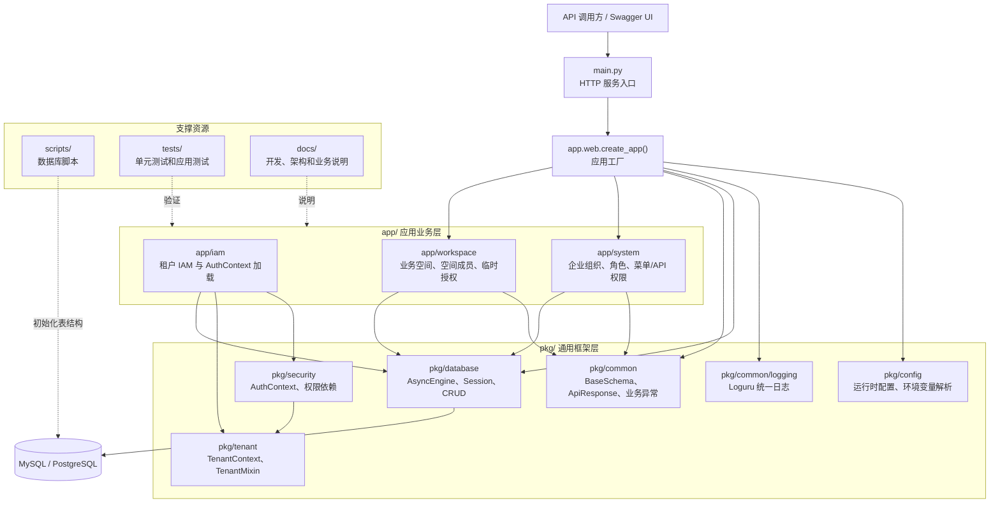
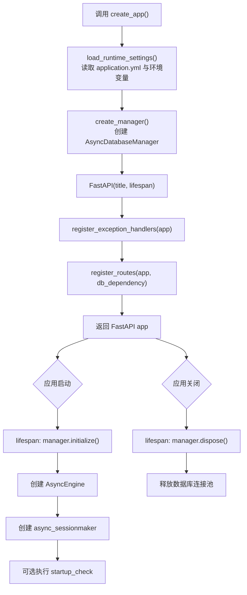
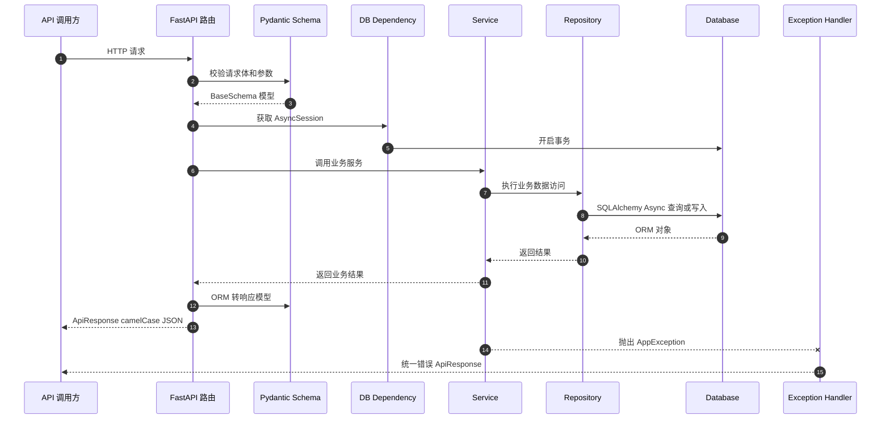
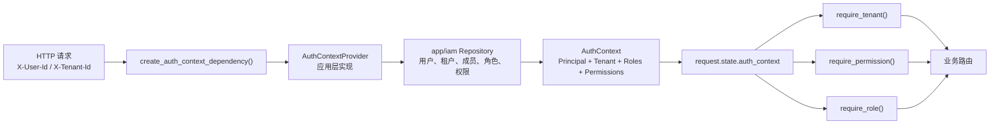
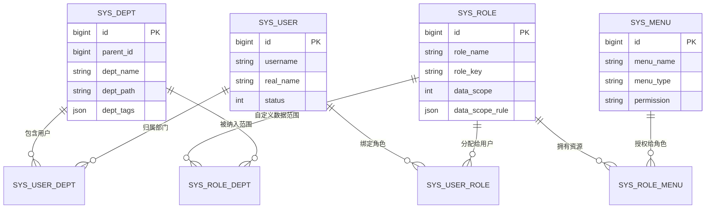
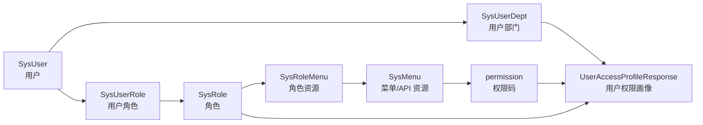
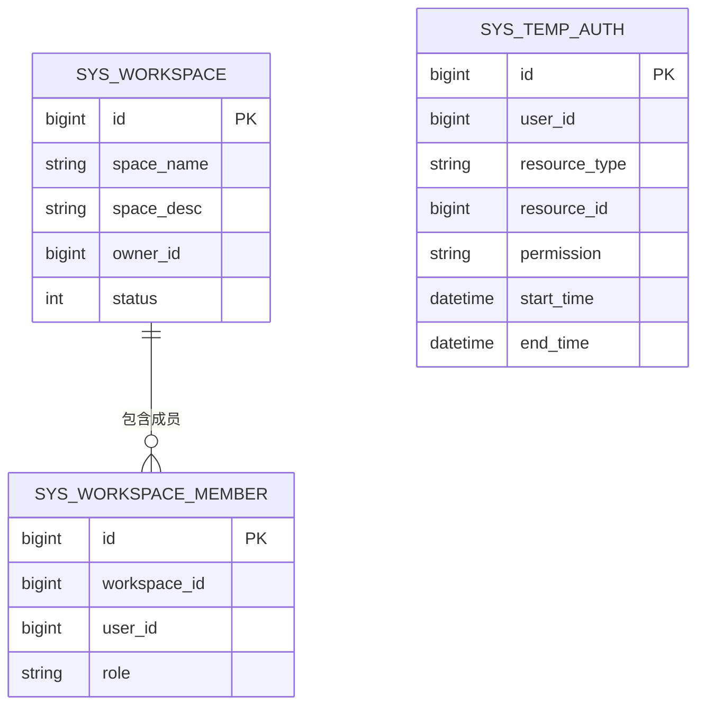
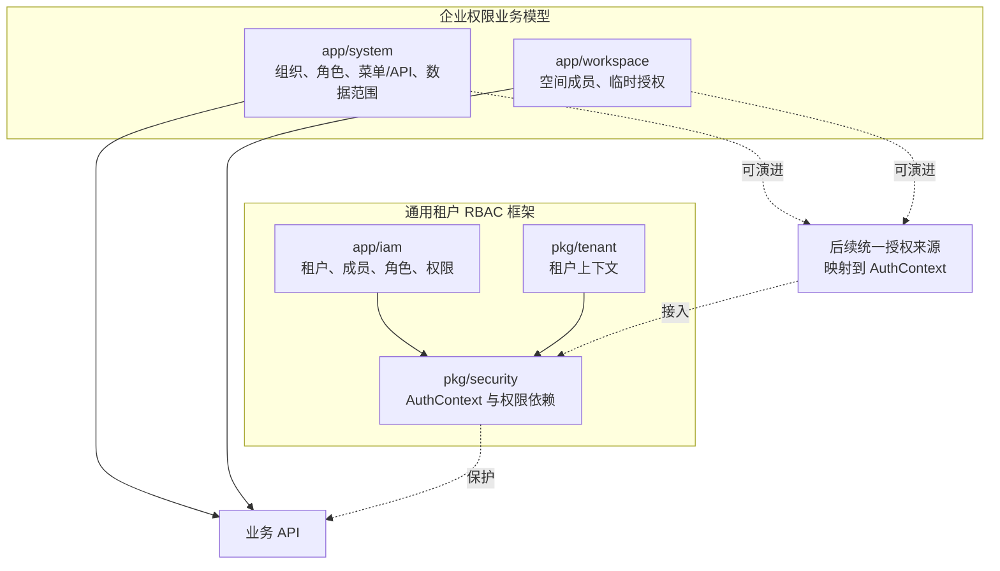

# 架构文档

## 系统定位

PythonBase 是一个 FastAPI 后端基础框架，同时包含企业权限和业务空间的参考实现。系统把稳定的通用能力沉淀到 `pkg/`，把可替换、可演进的业务能力放在 `app/`。

当前架构重点解决四类问题：

- API 模型和响应结构统一。
- 配置、数据库和应用生命周期统一。
- 租户、认证上下文和权限依赖可复用。
- 企业组织权限、业务空间和临时授权有清晰扩展样例。

## 总体分层

### 总体架构图



```text
HTTP 入口
  -> main.py
  -> app.web.create_app()

应用业务层 app/
  -> app/system：企业组织、用户、角色、菜单/API 权限
  -> app/workspace：业务空间、空间成员、临时授权
  -> app/iam：租户 IAM 与 AuthContext 加载示例

通用框架层 pkg/
  -> pkg/common：BaseSchema、ApiResponse、业务异常
  -> pkg/config：运行时配置和环境变量解析
  -> pkg/database：异步数据库、Session、CRUD
  -> pkg/security：认证上下文、权限判断、FastAPI 依赖
  -> pkg/tenant：租户上下文、TenantMixin、租户解析

支撑资源
  -> scripts：数据库脚本
  -> tests：单元测试和应用测试
  -> docs：设计、开发、架构和业务说明
```

依赖方向：

```text
main.py -> app.web -> app/* -> pkg/*
pkg/* 不依赖 app/*
```

该依赖方向保证 `pkg/` 可以作为通用框架层复用，业务模块可以按项目需要替换或扩展。

## 应用启动生命周期

应用创建入口是 `app.web.create_app()`：



```text
create_app()
  -> load_runtime_settings()
  -> create_manager(runtime_settings.database)
  -> 创建 FastAPI(lifespan=lifespan)
  -> register_exception_handlers(app)
  -> register_routes(app, db_dependency)
  -> 返回 app
```

`lifespan` 管理数据库生命周期：

```text
应用启动
  -> manager.initialize()
  -> 创建 AsyncEngine 和 async_sessionmaker
  -> 可选执行数据库连通性检查

应用关闭
  -> manager.dispose()
  -> 释放连接池
```

`main.py` 同时提供 ASGI 应用对象和本地启动函数：

```text
uv run python main.py
  -> uvicorn.run(app, host="127.0.0.1", port=8000)
```

## 请求处理流程

当前业务接口的典型流程：



```text
HTTP 请求
  -> FastAPI 路由
  -> Pydantic 请求模型校验
  -> 数据库 Session 依赖创建事务
  -> Repository 注入到 Service
  -> Service 执行业务校验和编排
  -> Repository 执行 SQLAlchemy 查询或写入
  -> 路由将 ORM 对象转换为响应模型
  -> ApiResponse 包装响应
  -> BaseSchema 按 camelCase 序列化
```

异常流程：

```text
Service 或基础设施抛出 AppException
  -> FastAPI 全局异常处理器捕获
  -> 转换为统一 ApiResponse
```

## API 模型架构

`pkg/common/api.py` 是接口模型基础：

- `BaseSchema`：所有请求和响应模型的基类。
- `SafeBigInt`：大整数 JSON 序列化为字符串。
- `SafeDatetime`：统一时间解析和序列化格式。
- `ApiResponse[T]`：统一响应结构。
- `PageParams`、`PageData[T]`：分页请求和响应基础模型。

序列化约定：

```text
Python 内部字段：snake_case
JSON 入站字段：snake_case 或 camelCase
JSON 出站字段：camelCase
```

因此业务代码保持 Python 风格命名，对外 API 保持前端友好的驼峰字段。

## 数据库架构

数据库基础设施位于 `pkg/database`：

- `Base`：SQLAlchemy DeclarativeBase。
- `build_async_database_url()`：构造异步数据库 URL。
- `AsyncDatabaseManager`：管理 Engine 和 SessionFactory。
- `create_db_session_dependency()`：写接口事务 Session 依赖。
- `create_readonly_db_session_dependency()`：只读 Session 依赖。
- `BaseCrud`：通用 CRUD。
- `TenantAwareCrud`：租户感知 CRUD。

事务边界：

```text
FastAPI Dependency
  -> async with manager.transaction() as session
  -> 路由和服务共用同一个 AsyncSession
  -> 正常返回时提交
  -> 异常时回滚
```

仓储层只做 `flush()` 和必要的 `refresh()`，不直接提交事务。这样可以让一个接口内的多个写操作共享同一事务。

## 通用租户与权限架构

通用权限模型由 `pkg/security` 和 `pkg/tenant` 提供。



核心对象：

| 对象 | 作用 |
| --- | --- |
| `Principal` | 当前认证主体。 |
| `TenantContext` | 当前租户上下文。 |
| `AuthContext` | 当前请求的用户、租户、成员、角色和权限快照。 |
| `AuthContextProvider` | 应用层加载授权上下文的协议。 |

权限依赖：

```text
create_auth_context_dependency(provider)
  -> 从 X-User-Id / X-Tenant-Id 加载 AuthContext
  -> 写入 request.state.auth_context

require_tenant()
require_permission()
require_any_permission()
require_role()
  -> 从 request.state.auth_context 读取并校验
```

框架层只依赖 `AuthContextProvider` 协议，不直接依赖具体 IAM 表结构。当前 `app/iam` 提供基于租户成员、角色和权限关系的上下文加载示例。

## 企业组织权限模块

模块路径：`app/system`

### 职责

该模块负责企业组织、用户、角色、菜单/API 资源和数据权限基础数据。

### 数据模型



| ORM | 表 | 说明 |
| --- | --- | --- |
| `SysDept` | `sys_dept` | 部门，支持层级、路径和标签。 |
| `SysUser` | `sys_user` | 企业用户。 |
| `SysUserDept` | `sys_user_dept` | 用户部门关系，支持主部门。 |
| `SysRole` | `sys_role` | 角色，包含数据权限范围。 |
| `SysMenu` | `sys_menu` | 菜单、按钮、API 资源。 |
| `SysRoleMenu` | `sys_role_menu` | 角色与菜单/API 资源关系。 |
| `SysUserRole` | `sys_user_role` | 用户与角色关系。 |
| `SysRoleDept` | `sys_role_dept` | 角色自定义部门范围。 |

### 权限画像流程



```text
用户
  -> 用户部门关系
  -> 用户角色关系
  -> 角色菜单关系
  -> 菜单 permission 字段
  -> UserAccessProfileResponse
```

`SystemService.get_user_access_profile()` 输出：

- 用户 ID。
- 所属部门列表。
- 主部门。
- 角色 ID。
- 角色编码。
- 权限码列表。

### 数据权限边界

`SysRole.data_scope` 当前支持保存以下范围：

| 值 | 含义 |
| --- | --- |
| `1` | 全部数据 |
| `2` | 本部门及以下 |
| `3` | 仅本部门 |
| `4` | 仅本人 |
| `5` | 自定义部门 |
| `6` | 按标签 |

当前已完成数据结构、枚举校验和自定义部门关系维护。实际业务查询中的数据范围过滤器尚未统一实现。

## 业务空间与临时授权模块

模块路径：`app/workspace`

### 职责

该模块负责业务空间、空间成员和短期资源授权。

### 数据模型



| ORM | 表 | 说明 |
| --- | --- | --- |
| `SysWorkspace` | `sys_workspace` | 业务空间。 |
| `SysWorkspaceMember` | `sys_workspace_member` | 空间成员和空间角色。 |
| `SysTempAuth` | `sys_temp_auth` | 临时授权。 |

### 空间成员

空间角色：

```text
OWNER
ADMIN
MEMBER
GUEST
```

`WorkspaceService.add_member()` 会校验空间存在和角色值合法，然后写入成员关系。

### 临时授权

临时授权包含：

- 用户 ID。
- 资源类型。
- 资源 ID。
- 权限码。
- 起止时间。
- 授权原因。

校验规则：

```text
user_id 相等
resource_type 相等
resource_id 相等
permission 相等
start_time <= 当前时间 <= end_time
```

当前临时授权作为独立业务能力存在，尚未接入 `pkg/security` 作为统一权限依赖的兜底策略。

## 模块协作关系

当前系统存在两类权限能力：



```text
app/iam + pkg/security + pkg/tenant
  -> 通用租户 RBAC 框架
  -> 面向请求上下文、租户隔离和权限依赖

app/system + app/workspace
  -> 企业组织权限和业务资源模型
  -> 面向组织结构、数据权限范围、空间成员和临时授权
```

二者的关系是“基础框架 + 业务模型示例”。后续如果要形成完整生产权限链路，需要明确主授权来源，并把 `app/system` 的角色权限或 `app/iam` 的租户角色权限统一映射到 `AuthContext`。

## 当前 API 边界

### `/system`

| 方法 | 路径 | 说明 |
| --- | --- | --- |
| `POST` | `/system/departments` | 创建部门。 |
| `GET` | `/system/departments` | 查询部门列表。 |
| `POST` | `/system/users` | 创建用户。 |
| `GET` | `/system/users` | 查询用户列表。 |
| `POST` | `/system/users/{user_id}/departments` | 关联用户和部门。 |
| `POST` | `/system/roles` | 创建角色。 |
| `GET` | `/system/roles` | 查询角色列表。 |
| `POST` | `/system/menus` | 创建菜单/API 资源。 |
| `GET` | `/system/menus` | 查询菜单/API 资源列表。 |
| `POST` | `/system/roles/{role_id}/menus` | 关联角色和菜单/API 资源。 |
| `POST` | `/system/users/{user_id}/roles` | 关联用户和角色。 |
| `POST` | `/system/roles/{role_id}/departments` | 关联角色和自定义数据权限部门。 |
| `GET` | `/system/users/{user_id}/access-profile` | 查询用户权限画像。 |

### `/workspaces`

| 方法 | 路径 | 说明 |
| --- | --- | --- |
| `POST` | `/workspaces` | 创建业务空间。 |
| `GET` | `/workspaces` | 查询业务空间列表。 |
| `POST` | `/workspaces/{workspace_id}/members` | 添加空间成员。 |
| `GET` | `/workspaces/{workspace_id}/members` | 查询空间成员。 |
| `POST` | `/workspaces/temp-auth` | 授予临时权限。 |
| `GET` | `/workspaces/temp-auth/check` | 校验临时权限是否有效。 |

## 已知边界

当前已经具备：

- FastAPI 应用工厂和生命周期管理。
- 异步数据库基础设施。
- 统一 API 模型和异常响应。
- 通用租户、认证上下文和权限依赖。
- 企业组织权限数据结构和 API。
- 业务空间和临时授权 API。
- 企业权限与空间表结构 SQL 脚本。

当前尚未完整实现：

- `app/system` 与 `app/iam` 的主授权模型统一。
- 企业角色 `data_scope` 到业务 SQL 过滤条件的自动转换。
- 临时授权作为统一权限依赖兜底策略。
- 空间成员角色到 `AuthContext.roles` 的自动映射。
- 权限缓存、审计日志和权限变更失效机制。

## 推荐演进方向

后续演进建议：

1. 明确 `app/iam` 和 `app/system` 的主授权来源。
2. 为 `/system` 和 `/workspaces` 接口接入认证和权限依赖。
3. 实现 `data_scope` 查询过滤器。
4. 将临时授权接入统一权限判断链路。
5. 增加审计日志和权限缓存。
6. 引入正式数据库迁移工具管理脚本演进。
