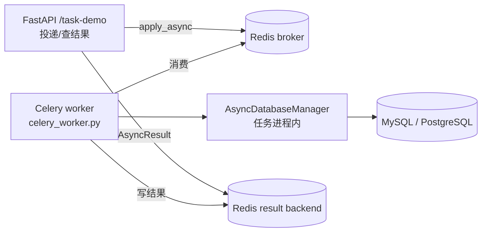

# Celery 任务扩展指南

本文介绍如何在 PythonBase 中扩展 Celery 异步任务能力。按 "从零加一个业务任务" 的主线讲解，覆盖任务编写、注册、启动、重试、异步数据库访问、定时调度、HTTP 投递与测试，最后附故障排查。

架构与配置字段的完整说明见 [docs/DEVELOPMENT.md](DEVELOPMENT.md) 的「异步任务开发（Celery）」章节与 [docs/ARCHITECTURE.md](ARCHITECTURE.md) 的「异步任务架构（Celery）」章节。

## 背景：什么时候用异步任务

- 需要把**耗时的、非请求关键路径**的工作移出 HTTP 请求（如发送通知、生成报表、批量导入）。
- 需要**定时执行**（如每天凌晨对账、清理过期数据）。
- 需要**失败重试**与**退避**（如调用外部服务不稳定）。

一句话架构：HTTP 进程把任务投递到 Redis broker → Celery worker 进程消费执行 → 结果写回 Redis result backend → 调用方通过 `task_id` 查询结果。



## 添加你的第一个业务任务

### 1. 建任务模块

在业务模块下建 `tasks.py`（例如 `app/orders/tasks.py`）：

```python
"""订单域异步任务。"""

from sqlalchemy.ext.asyncio import AsyncSession

from pkg.celery.app import get_celery_app
from pkg.celery.runner import run_async_in_task
from pkg.common.logging import get_logger

logger = get_logger(__name__)

# 复用进程级 Celery 应用；任务通过它注册。
_celery = get_celery_app()


@_celery.task(name="orders.sync_status")
def sync_order_status(order_id: int) -> str:
    """同步订单状态（示例任务）。

    使用方式:
        ``sync_order_status.delay(order_id=42)`` 或
        ``sync_order_status.apply_async(kwargs={"order_id": 42})``。
    """
    logger.info("orders.sync_status 收到 order_id={}", order_id)

    async def _work(db: AsyncSession) -> str:
        # 你的异步 DB 逻辑。写操作结束由 transaction() 自动提交。
        return "synced"

    return run_async_in_task(_work)
```

约定：

- 任务必须是**同步函数**（Celery worker 按同步执行模型调度），异步逻辑通过 `run_async_in_task` 跑。
- `name` 是任务的**注册名**，跨进程稳定（broker / beat / 结果查询都用它），建议按 `模块.动作` 命名。
- 需要访问 `self`（重试、请求上下文）时用 `bind=True`，见下文「重试与退避」。

### 2. 注册任务模块

Celery 通过 `include` 配置在启动时加载任务模块。默认只有 `pkg.celery.tasks`（[pkg/config/models.py](../pkg/config/models.py) 的 `CelerySettings.include` 默认值）。

在 [application.yml](../application.yml) 的 `celery` 段显式列出全部任务模块（**会整体覆盖默认值**）：

```yaml
celery:
  include:
    - pkg.celery.tasks      # 保留默认示例任务（可删）
    - app.orders.tasks      # 你的新任务模块
```

### 3. 启动 worker

```bash
# 启动 Redis（如已安装可跳过）
docker run -d -p 6379:6379 redis:7-alpine

# 启动 worker，include 中的模块会被自动加载
uv run python celery_worker.py
```

> **重要**：请始终用 `uv run python celery_worker.py` 启动 worker。该入口会注入任务进程内的数据库管理器，任务里 `run_async_in_task` 才能访问数据库。如果改用 `uv run celery -A pkg.celery.app:celery_app worker`，任务内访问数据库会抛 `RuntimeError`（数据库管理器未初始化）。

### 4. 从 FastAPI 投递

```python
from pkg.celery.app import get_celery_app


# 在请求处理器中（配置来自 request.app.state.settings，与当前应用一致）
app = get_celery_app(request.app.state.settings)
result = app.send_task("orders.sync_status", kwargs={"order_id": 42})
# 或者惰性导入任务模块后直接调用（推荐，保留类型与 IDE 提示）：
# import app.orders.tasks
# result = app.orders.tasks.sync_order_status.delay(order_id=42)

task_id = result.id  # 返回给调用方，用于查询结果
```

## 重试与退避

在任务装饰器上配置默认策略，任务内用 `self.retry` 显式触发：

```python
@_celery.task(
    name="orders.sync_status",
    bind=True,                    # 需要 self（重试、请求上下文）
    max_retries=3,                # 也可由配置 celery.max_retries 全局控制
    retry_backoff=True,           # 指数退避
    retry_backoff_max=600,
    retry_jitter=True,
)
def sync_order_status(self, order_id: int) -> str:
    """同步订单状态，失败时按指数退避重试。"""
    try:
        ...  # 业务逻辑
    except TemporaryError:
        # 首次失败 countdown=2^0=1s，之后 2s、4s ...（受 retry_backoff_max 封顶）
        raise self.retry(countdown=2 ** self.request.retries)
    return "synced"
```

相关配置项（全局默认，单任务装饰器可覆盖）：

| 配置字段 | 含义 |
| --- | --- |
| `celery.max_retries` | 默认最大重试次数（映射 `task_default_max_retries`）。 |
| `celery.retry_backoff` | 是否自动指数退避（映射 `task_retry_backoff`）。 |
| `celery.retry_backoff_max` | 退避上限秒数。 |
| `celery.retry_jitter` | 是否加入随机抖动，避免重试风暴。 |

## 异步数据库访问

Celery 任务本身是同步的，异步 DB 逻辑统一通过 `pkg.celery.runner.run_async_in_task` 执行：

```python
from pkg.celery.runner import run_async_in_task


def run_in_db(routine):
    """在事务边界内执行一段异步 DB 例程（写路径，自动提交）。"""
    return run_async_in_task(routine)


async def _read_something(db: AsyncSession) -> list[str]:
    result = await db.execute(select(...))
    return result.scalars().all()


# 只读路径：transaction=False 走 session() 边界
values = run_async_in_task(_read_something, transaction=False)
```

要点：

- 复用 worker 进程内唯一的数据库管理器（由 `celery_worker.py` 装配），不新建连接池。
- 异步 engine 绑定创建它的事件循环，而 `run_async_in_task` 每次 `asyncio.run` 新建事件循环，因此每次任务执行后会释放引擎，下次任务在新循环上重建。**不要**在已运行的异步上下文（如 FastAPI 依赖）里调用它。
- 更复杂的编排可直接拿到 `AsyncDatabaseManager`：`from pkg.celery.deps import get_task_db_manager`。

## 定时任务（beat）

无需写代码，在 [application.yml](../application.yml) 的 `celery.beat` 段声明 cron 即可：

```yaml
celery:
  beat:
    enabled: true          # worker 进程同时运行 beat
    schedules:
      - task: "orders.sync_status"   # 任务注册名，不是模块路径
        schedule: "0 3 * * *"        # 5 字段 cron：分 时 日 月 周（按 timezone 解释）
        args: [42]                   # 可选，位置参数
        kwargs: {}                   # 可选，关键字参数
        options: {}                  # 可选，透传到 Celery entry（如 queue、expires）
```

cron 字段支持 `*`、`*/n`、`a-b`、`0,15,30`，且各字段有范围校验。启动：

```bash
APP_CELERY__BEAT_ENABLED=true uv run python celery_worker.py
```

## 从 FastAPI 投递并查询结果

### 投递

```python
async_result = task.apply_async(args=[...])       # 等价于 task.delay(...)
task_id = async_result.id
```

### 查询结果

```python
app = get_celery_app(request.app.state.settings)
if app.conf.result_backend is None:
    # 未配置结果后端时无法查询（项目内返回 400 业务错误）
    ...
result = app.AsyncResult(task_id)
result.state   # PENDING / STARTED / SUCCESS / FAILURE ...
result.result  # 任务返回值（有结果后端时可用）
```

注意：`eager` 模式（测试/本地无 Redis）下任务在进程内同步执行，结果不经过结果后端；`/task-demo/result/{task_id}` 在未配置 `result_backend` 时返回业务错误。

## 测试

遵循项目约定：**eager 模式，不连真实 Redis**。参考 `tests/pkg/celery/conftest.py` 的 fixture。

```python
import importlib
import pytest

from pkg.celery.app import get_celery_app, reset_celery_app
from pkg.config import CelerySettings, RuntimeSettings


@pytest.fixture()
def orders_app():
    """构建 eager 测试应用，并重载待测任务模块使其绑定到本应用。"""
    import app.orders.tasks as tasks_module

    reset_celery_app()
    app = get_celery_app(RuntimeSettings(celery=CelerySettings(
        task_always_eager=True,
        task_store_eager_result=True,
        task_eager_propagates=False,
        result_backend=None,
    )))
    importlib.reload(tasks_module)
    yield app, tasks_module
    reset_celery_app()
    importlib.reload(tasks_module)


def test_sync_order_status(orders_app):
    """同步订单状态任务应返回预期结果。"""
    _, tasks_module = orders_app
    result = tasks_module.sync_order_status.delay(order_id=42)
    assert result.state == "SUCCESS"
    assert result.result == "synced"
```

需要访问数据库的任务，参考 `tests/pkg/celery/test_runner.py`：用 `pkg.celery.deps.set_task_db_manager` 注册一个桩管理器，断言 `initialize → transaction → dispose` 调用序列，或 mock 会话。

## 三种扩展路径速查

| 需求 | 做法 | 需要改的文件 |
| --- | --- | --- |
| 加一个业务任务 | 建 `tasks.py` 模块，`@_celery.task` 注册，加入 `include` | 新 `app/xxx/tasks.py`、`application.yml` |
| 加定时任务 | 在 `celery.beat.schedules` 声明 cron | `application.yml` |
| 分队列 / 多 worker 实例 | 需要扩展 `task_routes` 配置与 worker 入口（当前未内置） | `pkg/config/models.py`、`pkg/celery/app.py`、`celery_worker.py` |

## 故障排查

| 症状 | 原因 | 解决 |
| --- | --- | --- |
| 启动报 `Unable to load celery application` / 任务没注册 | 任务模块没进 `include` | 在 `celery.include` 显式列出模块路径 |
| 任务内访问 DB 抛 `RuntimeError: 任务数据库管理器未初始化` | 用 `celery -A ...` 启动，未注入 DB 管理器 | 改用 `uv run python celery_worker.py` |
| 本地/测试无 Redis 时 `apply_async` 尝试连接被拒 | eager 模式未生效，或配置了结果后端 | 测试/本地设置 `celery.task_always_eager=true`；eager 下不要配 `result_backend` |
| `GET /task-demo/result/{task_id}` 返回 400 | 未配置 `result_backend` | 生产配置 `celery.result_backend`；eager 下结果走进程内存不经后端 |
| beat 任务不触发 | `celery.beat.enabled` 未开，或 cron 字段错 | 用 `APP_CELERY__BEAT_ENABLED=true` 启动，检查 cron 5 字段与时区 |
